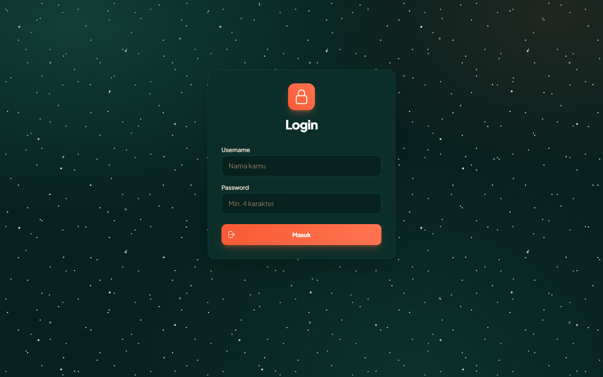
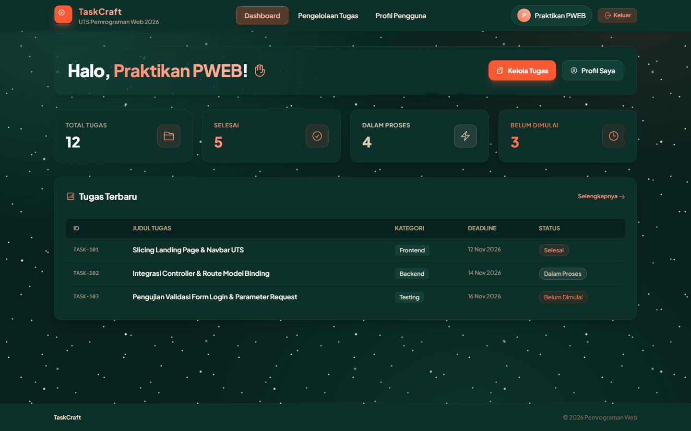
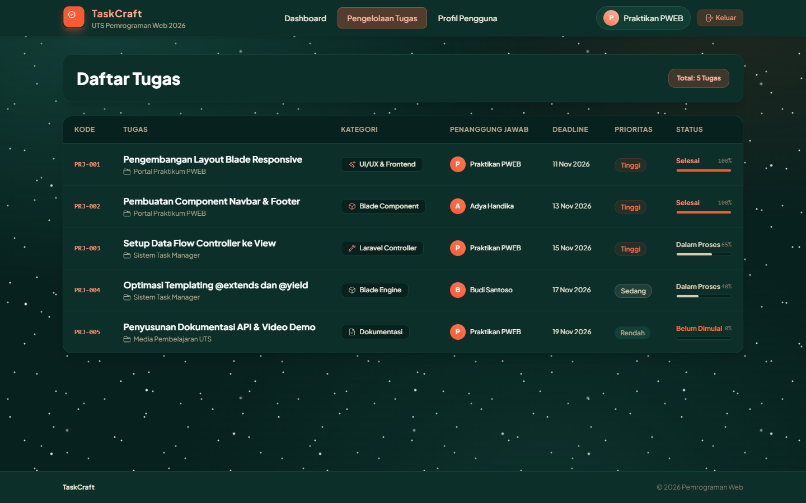
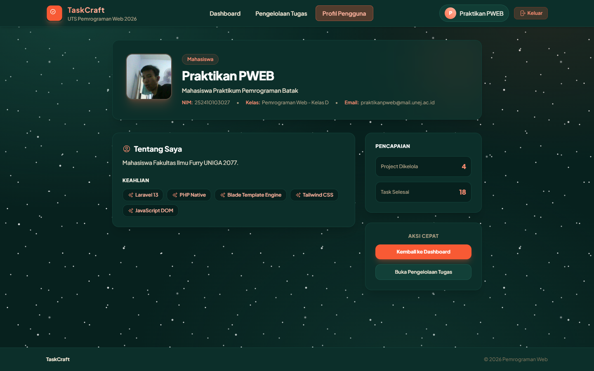
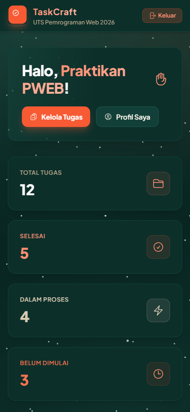

# TaskCraft — UTS Pemrograman Web 2026

Aplikasi web pengelolaan tugas & project berbasis **Laravel murni** (tanpa starter kit, tanpa database)
dengan sistem templating **Blade**. Dibuat untuk memenuhi UTS mata kuliah Pemrograman Web 2026.

## Identitas

| | |
|---|---|
| **Nama** | Rafael Ababil Ainur Hadi |
| **NIM** | 252410103027 |
| **Kelas** | Pemrograman Web - Kelas D |
| **Mata Kuliah** | Pemrograman Web 2026 |
| **Tema Web** | Pengelolaan Tugas & Project (Task Manager) |
| **Stack** | Laravel 13 · Blade · Tailwind CSS (Vite) · JavaScript vanilla |

---

## Penjelasan Singkat Web

**TaskCraft** adalah aplikasi pengelolaan tugas dan project. Aplikasi ini dipakai untuk mencatat daftar
pekerjaan, siapa penanggung jawabnya, deadline, prioritas, serta progres pengerjaannya.

Alur utama aplikasi ini adalah **simulasi login yang meneruskan data username ke halaman berikutnya**:

1. Di halaman **Login**, pengguna mengisi username dan password.
2. Form dikirim dengan `POST` ke `PageController@handleLogin`, di sana datanya divalidasi
   (`required`, `max:50`, `min:4`).
3. Setelah valid, username diteruskan sebagai *Request Parameter* ke halaman berikutnya
   (`/dashboard?username=...`), lalu diteruskan terus ke halaman **Profil** dan **Pengelolaan Tugas**.
4. Setiap halaman memanggil datanya lewat Controller — tidak ada isi yang di-hardcode di blade view.
   Data yang tampil (statistik, list tugas, list project, skill, dsb.) dikirim Controller dalam bentuk
   array dan di-render dengan perulangan `@foreach`.

Catatan sesuai ketentuan UTS: aplikasi ini **tidak memakai database / CRUD**, seluruh data masih berupa
array yang disiapkan di Controller.

---

## Screenshot

### 1. Halaman Login

Halaman masuk. Setelah submit, username diteruskan ke halaman berikutnya lewat Request Parameter.



### 2. Halaman Dashboard

Dashboard menampilkan sapaan berisi username yang dikirim dari form login, kartu statistik
(total, selesai, dalam proses, belum dimulai), dan tabel ringkasan tugas terbaru.



### 3. Halaman Pengelolaan Tugas

Halaman pengelolaan menampilkan data list dari Controller yang di-render memakai perulangan `@foreach`:
kode task, nama tugas & project, kategori, penanggung jawab, deadline, prioritas, serta bar progres.



### 4. Halaman Profil

Halaman profil pengguna, datanya juga dikirim dari Controller (bukan hardcode di view).



### 5. Tampilan Responsif (Mobile)

Layout dibangun responsif memakai utility class, jadi tampilannya tetap rapi di layar kecil.



---

## Struktur File Utama

Sembilan file inti sesuai ketentuan UTS:

| No | Bagian | File |
|----|--------|------|
| 1 | Route | `routes/web.php` |
| 2 | Controller | `app/Http/Controllers/PageController.php` |
| 3 | Layout Utama | `resources/views/layouts/app.blade.php` |
| 4 | View Login | `resources/views/login.blade.php` |
| 5 | View Dashboard | `resources/views/dashboard.blade.php` |
| 6 | View Pengelolaan | `resources/views/pengelolaan.blade.php` |
| 7 | View Profile | `resources/views/profile.blade.php` |
| 8 | Component Navbar | `resources/views/components/navbar.blade.php` |
| 9 | Component Footer | `resources/views/components/footer.blade.php` |

File pendukung:

- `resources/views/components/` → komponen Blade (`navbar`, `footer`) yang dipanggil dari layout.
- `public/images/` → aset statis (ikon SVG, logo, foto profil), dipanggil dengan helper `asset()`.
- `resources/css/app.css` → tema warna (Tailwind v4 `@theme`) beserta latar bintang di background.
- `resources/js/app.js` → entry point JavaScript dari Vite.

## Penerapan Materi

**MVC Pattern**

- Route hanya mengarahkan request ke Controller: `Route::get('/dashboard', [PageController::class, 'dashboard'])`.
- Controller (`PageController`) menyiapkan data lalu memanggil view: `return view('dashboard', compact('username', 'stats', 'recentTasks'));`
- View tidak menyimpan data sendiri, semua nilai yang tampil berasal dari Controller.

**Blade Engine**

| Directive | Dipakai di |
|---|---|
| `@extends` | Layout utama dipakai ulang oleh 4 view |
| `@section` / `@endsection` | `title` dan `content` di setiap view |
| `@yield` | `layouts/app.blade.php` (title & content) |
| `@include` | `components/footer.blade.php` |
| Component (`<x-navbar />`) | `components/navbar.blade.php` |
| `@foreach` | tabel tugas terbaru (dashboard) & tabel pengelolaan |
| `@if` / `@elseif` | warna badge status dan prioritas |

**Request Handling**

- `POST /login` → `PageController@handleLogin` → validasi → `redirect()->route('dashboard', ['username' => $username])`
- Username diterima lagi oleh halaman Dashboard, Pengelolaan, dan Profile lewat `$request->query('username')`
- Link di navbar ikut membawa username, jadi data pengguna tetap konsisten saat berpindah halaman.

---

## Cara Menjalankan Project

```bash
# 1. install dependency PHP & JavaScript
composer install
npm install

# 2. siapkan file environment
cp .env.example .env
php artisan key:generate

# 3. build aset CSS/JS
npm run build          # sekali saja (atau: npm run dev saat sedang ngoding)

# 4. jalankan server
php artisan serve
```

Lalu buka `http://127.0.0.1:8000` (port bisa berbeda sesuai output terminal).
Halaman depan otomatis diarahkan ke halaman login.

Alur demo: **Login → Dashboard → Profil → Pengelolaan Tugas**.

## Catatan Teknis

- Tanpa database: seluruh data disiapkan sebagai array di Controller.
- CSS memakai Tailwind yang di-compile lewat Vite dari `resources/css/app.css`
  (tema warna & latar bintang didefinisikan di `@theme`, tanpa file `tailwind.config.js`).
- Sudah `npm run build`, jadi hasil compile CSS/JS ada di `public/build/` dan aplikasi
  tetap tampil normal walaupun tanpa menjalankan `npm run dev`.
